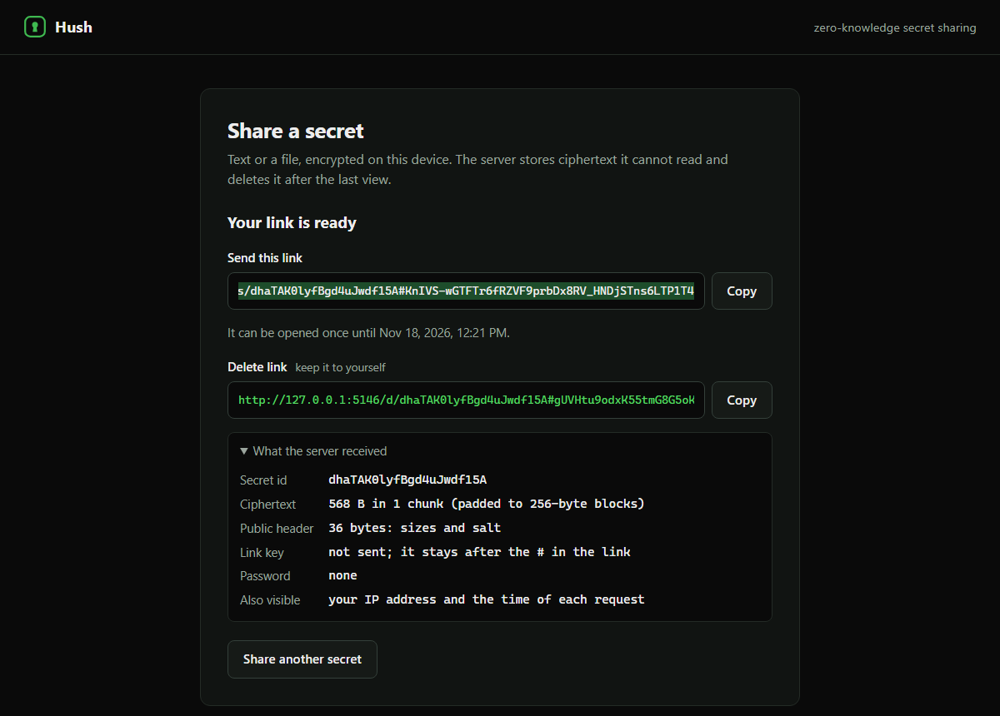
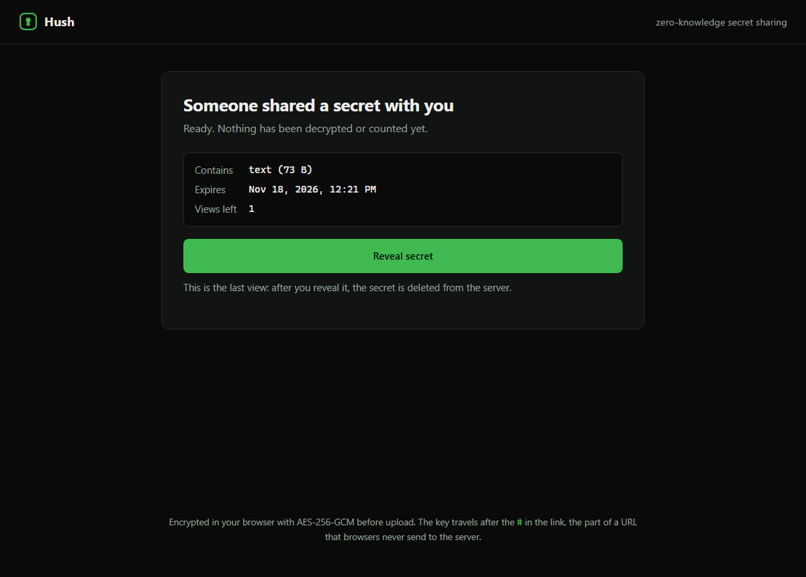
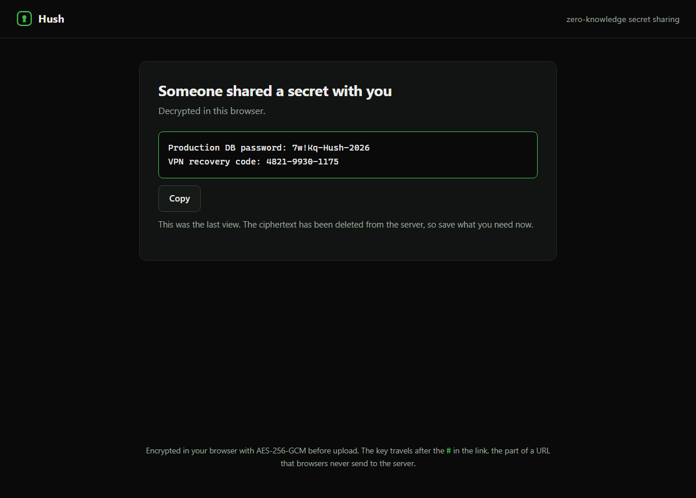

<p align="center"></p>

# Hush

[](https://github.com/TIENDUNG21/hush-zero-knowledge-vault/actions/workflows/ci.yml)
[](LICENSE)

Hush is a self-hosted service for sharing a password, key or file through a one-time link. The browser or the `bin/hush` CLI encrypts with AES-256-GCM before upload, the key travels in the link's `#fragment`, and the PHP server stores ciphertext it cannot decrypt, then deletes it after the last view or at expiry.



A static page that explains the format and runs the real envelope code in your browser is at **[tiendung21.github.io/hush-zero-knowledge-vault](https://tiendung21.github.io/hush-zero-knowledge-vault/)**. It has no backend; Hush itself is something you run.

## The protocol

```
sender                                      server stores                 recipient
------                                      -------------                 ---------
k  = 32 random bytes            (never sent)
s  = 16-byte salt
pw = PBKDF2-SHA256(NFC(password), s, 600k)  (only with a password)
K  = HKDF-SHA256(k || pw, s, "hush/v1 content key")
header = "HUSH" v1 flags iterations s chunkSize chunkCount     header (36 B, public)
meta   = AES-GCM_K({kind,name,type,size} padded to 256 B)       meta record
chunk_i = AES-GCM_K(data padded to 256 B, split in 512 KiB)     chunk records
          AAD = header || kind || i                              views, expiry,
                                                                 SHA-256(delete token)
link = https://host/s/{id}#base64url(k)  ------------------------------------------>  reads k from location.hash
                                                                 POST /open: claim     re-derives K, verifies
                                                                 a view atomically,    every record, strips
                                                                 burn on the last      the padding
```

| Generated | Where | Reaches the server? |
|---|---|---|
| Fragment key `k` (256 bits) | sender's browser or CLI | No. It is after `#`, which browsers do not send, and `Referrer-Policy: no-referrer` is set. |
| Password | typed by sender and recipient | No. Only its PBKDF2 output enters HKDF, locally. |
| Salt, iterations, chunk size and count | sender | Yes, in the 36-byte public header. |
| File name, MIME type, true size | sender | Only encrypted, inside the metadata record. |
| Secret id (128 bits), deletion token (256 bits) | server | The server keeps the id and `SHA-256(token)`. |

Every record is authenticated together with the full header, its kind and its index, so a server that reorders, drops, duplicates or swaps chunks, or edits a header field, produces an authentication failure, not a wrong file. The password is mixed into HKDF next to `k` rather than replacing it, so a stolen database plus a guessed weak password still lacks 256 bits. The format is specified byte by byte in [docs/ARCHITECTURE.md](docs/ARCHITECTURE.md#envelope-format-v1) and pinned by [`tests/fixtures/vector-v1.json`](tests/fixtures/vector-v1.json), which the PHP and JavaScript implementations must both reproduce exactly.

## Usage

From a terminal (a real session against `php -S`; the CLI needs PHP 8.3 with OpenSSL and nothing from the server's JavaScript):

```
$ export HUSH_SERVER=http://127.0.0.1:5140
$ echo "staging DB password: example-only-4821" | hush send
http://127.0.0.1:5140/s/fH6D2z3CmqOxZYUbF8qHRg#sDt2Kdd-TEHEje0EGFX4j0bCBpwrxsklElb_hvk8UKE
Can be opened once until 2026-11-18 05:31 UTC.
Delete link (keep it private): http://127.0.0.1:5140/d/fH6D2z3CmqOxZYUbF8qHRg#GOj6-C5jltXzpiRhJqNmZck1XLk-0iOncK1uXAA5dMc
$ hush get 'http://127.0.0.1:5140/s/fH6D2z3CmqOxZYUbF8qHRg#sDt2Kdd-TEHEje0EGFX4j0bCBpwrxsklElb_hvk8UKE'
staging DB password: example-only-4821
That was the last view; the server has deleted it.
$ hush get 'http://127.0.0.1:5140/s/fH6D2z3CmqOxZYUbF8qHRg#sDt2Kdd-TEHEje0EGFX4j0bCBpwrxsklElb_hvk8UKE'
hush get: This secret does not exist, has expired or has already been viewed. (not_found)

$ HUSH_PW="correct horse" hush send --file q3-report.pdf --password-env HUSH_PW --expires 1h --views 3
http://127.0.0.1:5140/s/pv32i05UMa9P8PrBkeBKAw#A3O-0ke0AsfaWScxj2MfejA5tlitJ34XcyTaUlamRN0
Can be opened 3 times until 2026-11-17 06:31 UTC; send the password through another channel.
```

`hush` is `php bin/hush`. Passwords are read from stdin (`--password-stdin`) or an environment variable, never from argv. `get` checks the key and password against the encrypted metadata before it spends a view, refuses to overwrite files, and saves under the sender's base name only. `hush encrypt` and `hush decrypt` produce and open `.hush` packages without a server. Exit codes: 0 ok, 1 server or network error, 2 usage, 3 decryption failed.

In the browser, the recipient's page loads with nothing consumed (link-preview bots only ever `GET` it), shows the size, expiry and views left, verifies a password against the metadata first, and spends the view only on Reveal:

<p> </p>

## What the server can and cannot learn

It cannot learn the plaintext, the file name or type, the true size, the password or the link key. A database copy is ciphertext plus the public header.

It can see the ciphertext length rounded up to 256 bytes, the chunk count, whether a password was set, expiry and view counts, and the IP address and time of each request while the request runs. The application does not store addresses: rate-limit buckets are keyed by `HMAC-SHA256(server key, IPv4 address or IPv6 /64)` and deleted once refilled, and the Docker image writes no access log (the CI job checks that neither request lines nor secret ids appear in the container output). The sender is shown this list after every upload.

The full analysis, per STRIDE category with the code and test behind each answer, is in [docs/THREAT_MODEL.md](docs/THREAT_MODEL.md).

## Server hardening

Every response, errors included, carries:

```
Content-Security-Policy: default-src 'none'; script-src 'self'; style-src 'self'; img-src 'self' blob: data:;
  connect-src 'self'; font-src 'self'; manifest-src 'self'; form-action 'none'; base-uri 'none';
  frame-ancestors 'none'; require-trusted-types-for 'script'; trusted-types 'none'
Strict-Transport-Security: max-age=63072000; includeSubDomains
Referrer-Policy: no-referrer
Permissions-Policy: camera=(), microphone=(), geolocation=(), payment=(), usb=(), browsing-topics=()
Cross-Origin-Opener-Policy: same-origin        Cross-Origin-Embedder-Policy: require-corp
Cross-Origin-Resource-Policy: same-origin      X-Content-Type-Options: nosniff
Cache-Control: no-store                        X-Robots-Tag: noindex, nofollow
```

The pages have no inline script or style, and Trusted Types with an empty policy list makes `innerHTML` throw; the UI writes with `textContent` only. `form-action 'none'` means a broken script cannot fall back to posting a plaintext form.

Requests pass a fixed middleware order: security headers, error mapping, routing, an origin check (non-GET requests with a foreign `Origin` or `Sec-Fetch-Site` get 403; Hush sets no cookies), token-bucket rate limiting, then body limits. Each route names its bucket and its maximum body. A `Content-Length` over the limit is refused with 413 before a byte is read, `Transfer-Encoding: chunked` gets 411, and the body is read with a hard cap. Default buckets per client network, overridable with `HUSH_RATE_<NAME>=capacity,refill_per_second`:

| Bucket | Routes | Burst | Refill |
|---|---|---|---|
| `create` | `POST /api/secrets` | 30 | 1 per 20 s |
| `chunk` | `PUT .../chunks/{i}`, `POST .../seal` | 600 | 10/s |
| `read` | `GET /api/secrets/{id}`, `POST .../open` | 120 | 2/s |
| `delete` | `DELETE /api/secrets/{id}` | 30 | 0.5/s |
| `page` | pages, assets, `/healthz` | 300 | 5/s |

The last view is claimed by a single `UPDATE ... WHERE views < max_views RETURNING`, so concurrent readers of a one-view secret cannot both get it. A test starts six PHP processes on one SQLite file and checks that exactly one wins ([ADR 0004](docs/adr/0004-sqlite-and-a-single-statement-claim.md)).

## Running a server

```
docker compose up -d --build        # http://127.0.0.1:8080, data in the hush-data volume
```

The image (Apache with mod_php, `php:8.3-apache-bookworm`) runs as `www-data` on port 8080, read-only, with all capabilities dropped; a second service runs `hush-admin gc` every five minutes. Docker is not installed on the machine this was written on, so the image is built and tested in CI: the `docker` job starts the stack, checks health and headers, and does a CLI round trip against it.

Without Docker:

```
composer install --no-dev
php bin/hush-admin migrate
php -S 127.0.0.1:5140 public/index.php
```

| Variable | Default | |
|---|---|---|
| `HUSH_DB_PATH` | `var/hush.sqlite` | SQLite file |
| `HUSH_PUBLIC_ORIGIN` | from `Host` | public `https://` origin, used by the origin check |
| `HUSH_MAX_SECRET_BYTES` | 33554432 (32 MiB) | largest envelope a header may declare |
| `HUSH_MAX_TTL` | 604800 (7 days) | longest expiry |
| `HUSH_UPLOAD_WINDOW` | 900 | seconds to finish uploading chunks |
| `HUSH_TRUSTED_PROXIES` | none | comma-separated IPs whose `X-Forwarded-For` is honoured |
| `HUSH_RATE_<BUCKET>` | see above | `capacity,refill_per_second` |

Invalid values are not ignored: the front controller answers every request with 503 and logs the reason until the configuration is fixed. Serve it over HTTPS only; see [SECURITY.md](SECURITY.md#running-it-safely).

## Design

The server is plain PHP 8.3 with no runtime Composer packages: its own request and response objects, a router that distinguishes 404 from 405, a PSR-15-shaped middleware pipeline and an autowiring DI container with cycle detection ([ADR 0003](docs/adr/0003-framework-free-php-kernel.md)). SQLite through PDO holds the data, with checksummed SQL migrations. The browser client is vanilla ES modules type-checked by `tsc --checkJs --strict` and served as written, with no build step, so the code in the repository is the code the browser runs. The envelope code in `resources/assets/js/core/` has no DOM access and runs unchanged in Node, which is how the tests exercise it.

[docs/ARCHITECTURE.md](docs/ARCHITECTURE.md) walks through the request path, the secret lifecycle and the module layout. The decisions are recorded in [docs/adr/](docs/adr/): the key in the fragment, one format with two implementations, the framework-free kernel, and SQLite with a single-statement claim.

## Performance

Medians from `php scripts/bench.php` (PHP 8.3.36, OpenSSL 3.0.22, `php -S` with opcache, HTTP client ext-curl) and `node scripts/bench.mjs` (Node 22.19, WebCrypto), on an Intel i7-14700K with 32 GB RAM, Windows 11:

| Operation | PHP / OpenSSL | Node / WebCrypto |
|---|---|---|
| PBKDF2-SHA256 600,000 iterations + HKDF | 402 ms | 127 ms |
| Seal 32 MiB (64 chunks of 512 KiB) | 13 ms | 45 ms |
| Open and verify 32 MiB | 58 ms | 48 ms |
| HTTP round trip, 200-byte text (create, chunk, seal, status, open) | 13.4 ms | |
| HTTP round trip, 8 MiB file (16 chunks) | 174 ms | |

Password derivation dominates the cost of a small secret by design. Through `bin/hush` the round trip is slower than the curl figure: PHP's stream wrapper waits for `php -S` on Windows to close the socket, about 10 ms per request.

## Limitations

**A malicious server can serve malicious JavaScript.** The browser client comes from the server it is meant to distrust; an operator who edits `crypto.js` can read what is sent through the web page. This applies to every web-based end-to-end tool that loads code from its own origin. The CLI avoids it, since it encrypts with code already on your machine. Pinning the client (a browser extension, or a subresource-integrity manifest checked out of band) is not done.

**The link is the capability.** Anyone holding it can open the secret while views remain. A password, sent another way, is the second factor. A mail scanner that runs JavaScript and presses buttons would spend a view.

**Metadata is visible**: sizes to 256 bytes, timing, request IPs in flight, and the password flag.

**Deletion is best effort below SQLite.** `secure_delete` zeroes freed pages, but WAL copies until checkpoint and host backups keep what they captured. It is ciphertext, but use an encrypted disk and short backup retention.

**One host.** SQLite serialises writers; horizontal scaling would need a shared database behind `SecretRepository`. Uploads are capped at 32 MiB by default and held in browser memory while encrypting.

**Not done yet**: streaming encryption of files larger than memory in the browser, a client-pinning mechanism, an i18n layer for the UI (it is English only), and a published container image (CI builds it but does not push it).

## Tests

```
composer lint && composer stan && composer test     # PHP-CS-Fixer, PHPStan level max + strict rules, PHPUnit
npm run lint && npm run typecheck && npm test       # ESLint, tsc --checkJs, node --test
node scripts/browser-check.mjs                      # headless Edge/Chrome against php -S
node scripts/build-site.mjs && node scripts/check-site.mjs
```

248 PHPUnit tests (215 unit, 21 HTTP integration against a real `php -S` process, 12 PHP/JavaScript interoperability) and 46 Node tests. They cover hostile envelopes (truncation, bit flips in nonce, tag, header or ciphertext, reordered and duplicated chunks, absurd iteration counts), NFC versus NFD passwords, Vietnamese and astral-plane text, body limits, rate limiting, origin checks and the process race. The interop suite seals in PHP and opens in the browser module and the reverse, then has `bin/hush` and the browser client send to each other through one server. The browser check creates text, password and file secrets through the UI, opens a CLI-made link, and fails on any console error or CSP violation.

## Building from source

PHP 8.3 with `pdo_sqlite` and `openssl` (`intl` optional, for non-ASCII passwords in the CLI), Composer 2, Node 22.

```
git clone https://github.com/TIENDUNG21/hush-zero-knowledge-vault
cd hush-zero-knowledge-vault
composer install && npm ci
php bin/hush-admin migrate && php -S 127.0.0.1:5140 public/index.php
```

## References

- NIST SP 800-38D, *Recommendation for Block Cipher Modes of Operation: Galois/Counter Mode (GCM) and GMAC*, 2007.
- H. Krawczyk, P. Eronen, RFC 5869, *HMAC-based Extract-and-Expand Key Derivation Function (HKDF)*, 2010.
- K. Moriarty, B. Kaliski, A. Rusch, RFC 8018, *PKCS #5: Password-Based Cryptography Specification Version 2.1*, 2017.
- OWASP, *Password Storage Cheat Sheet* (PBKDF2-HMAC-SHA256 at 600,000 iterations).
- T. Berners-Lee, R. Fielding, L. Masinter, RFC 3986, *Uniform Resource Identifier: Generic Syntax*, section 3.5 (fragment), 2005.
- W3C, *Content Security Policy Level 3* and *Trusted Types*.
- A. Shostack, *Threat Modeling: Designing for Security*, Wiley, 2014 (STRIDE).

## License

MIT, see [LICENSE](LICENSE). No third-party data, fonts or assets are included.
