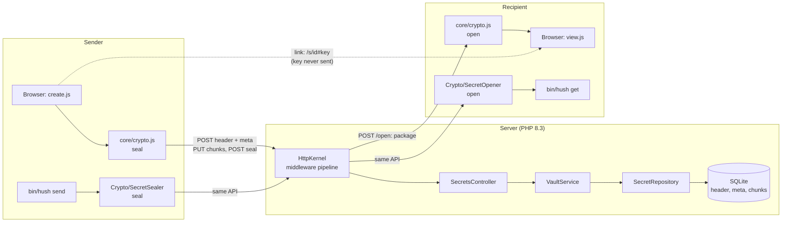
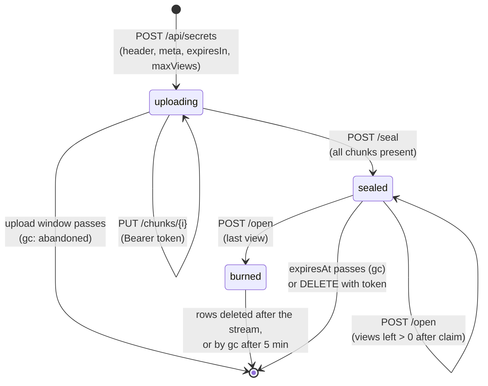

# Architecture

Hush has three programs that share one binary format: a browser client (vanilla ES modules on WebCrypto), a terminal client (`bin/hush`, PHP on OpenSSL) and a server (PHP 8.3, SQLite) that only stores what the clients give it. The format, not the server, is the centre of the design: if both clients produce and accept the same bytes, the server can stay ignorant of everything inside them.



## Envelope format v1

All integers are big-endian. One envelope is one secret.

```
header (36 bytes, public, stored by the server as-is)
  0  "HUSH"             magic
  4  u8   version = 1
  5  u8   flags         bit 0: password protected; other bits must be 0
  6  u16  reserved = 0
  8  u32  iterations    0 without password, else 100,000..5,000,000 (default 600,000)
 12  16   salt          random
 28  u32  chunkSize     1,024..1,048,576 (default 524,288)
 32  u32  chunkCount    >= 1

key schedule
  pw  = PBKDF2-HMAC-SHA256(NFC(password), salt, iterations, 32)        only with a password
  key = HKDF-SHA256(ikm = fragmentKey || pw, salt, "hush/v1 content key", 32)

record (one per meta and per chunk)
  nonce (12, random) || AES-256-GCM ciphertext || tag (16)
  AAD = header || kind (u8: 0 meta, 1 chunk) || index (u32)

meta plaintext
  {"kind":"text"|"file","name":?string,"type":?string,"size":int}
  right-padded with spaces to a multiple of 256 bytes, at most 4,096

payload plaintext
  data, zero-padded to max(256, ceil(len / 256) * 256), split into chunkSize pieces

package (what POST /open returns and what `bin/hush encrypt` writes)
  header || u32 metaLen || meta record || (u32 len || chunk record) * chunkCount
```

Three choices carry most of the security argument.

The AAD binds every record to the whole header, to its role and to its position. A server that reorders chunks, drops the last one, replays the metadata as a chunk or edits a header field gets an authentication failure, not a silently wrong file. Truncation is caught because `chunkCount` lives in the authenticated header, and the decoder additionally requires every chunk but the last to be exactly `chunkSize` bytes.

The fragment key is always part of the HKDF input, with or without a password. A password therefore adds to the link key; it never replaces it. Someone who steals the database and guesses a weak password still needs the 256-bit key from the link.

Padding to 256-byte blocks happens before encryption, in both the metadata and the payload, so a 3-byte PIN and a 200-byte API key produce the same ciphertext length. `meta.size` keeps the true length so the recipient can strip the padding.

The format is implemented twice: `resources/assets/js/core/format.js` + `crypto.js`, and `src/Crypto/*.php`. `tests/fixtures/vector-v1.json` holds a package generated with fixed key, salt and nonces (`tests/fixtures/make-vector.php`); `VectorTest.php` and `vector.test.mjs` must both reproduce it byte for byte and decrypt it. The interop suites go further and feed each side's output to the other ([ADR 0002](adr/0002-one-envelope-format-two-implementations.md)).

## Lifecycle of a secret



Creation and upload are separate so a 32 MiB file does not have to fit in one request or in PHP memory. The create call returns an id and a deletion token; the client then `PUT`s each encrypted chunk (at most 1 MiB + 28 bytes each) and finally seals. Nothing is readable until it is sealed, and an unsealed secret is removed when the upload window (15 minutes by default) closes.

Opening is a `POST`, never a `GET`. Chat apps, mail scanners and link-preview bots fetch the link with `GET /s/{id}`; that returns a static page that loads `view.js` and does nothing until a person presses Reveal. `GET /api/secrets/{id}` returns the public header, the encrypted metadata and the view count without consuming anything, which is what lets the page check a password against the metadata record before it spends a view.

The view is claimed by one statement:

```sql
UPDATE secrets SET views = views + 1,
       state = CASE WHEN views + 1 >= max_views THEN 'burned' ELSE state END, ...
 WHERE id = :id AND state = 'sealed' AND expires_at > :now AND views < max_views
RETURNING max_views - views
```

SQLite serialises writers, so two processes racing for the last view cannot both get a row back. `VaultConcurrencyTest` starts real PHP processes on separate connections to one database file and checks that exactly one wins a one-view secret and exactly three of six win a three-view secret ([ADR 0004](adr/0004-sqlite-and-a-single-statement-claim.md)).

The package is streamed: `VaultService::open` returns a generator that yields the header and meta, then one chunk row at a time, and deletes the rows in a `finally` block after the last view. If the client disconnects mid-stream, the secret is already `burned`, so it cannot be opened again, and `hush-admin gc` removes the rows after the five-minute grace period.

## Server

The server is about 3,000 non-blank lines of PHP (not counting the envelope code and the CLI) with no runtime dependencies; Composer is used for autoloading and development tools only ([ADR 0003](adr/0003-framework-free-php-kernel.md)).

```
public/index.php          front controller (php -S and Apache FallbackResource)
src/Http/                 Request, Response, HeaderBag, RequestFactory, ResponseEmitter
src/Kernel/               Application (composition root, routes), HttpKernel, ErrorMiddleware, DispatchHandler
src/Middleware/           Middleware and Handler interfaces, Pipeline
src/Routing/              Router (linear scan), Route, RouteMatch: 404 vs 405 with Allow
src/Container/            DI container: factories, shared instances, constructor autowiring, cycle detection
src/Security/             headers, origin check, rate limiting, body limits, client IP
src/Vault/                VaultService (rules), SecretRepository (SQL), ids, tokens, records
src/Crypto/               the envelope format in PHP (used by the CLI, the tests and size checks)
src/Storage/              PDO connection pragmas, Migrator (migrations/*.sql, checksummed)
src/Api/, src/Web/        controllers, templates, static assets with ETag revalidation
src/Cli/, src/Client/     bin/hush: argument parsing, commands, HTTP client over a transport interface
src/Admin/                bin/hush-admin: migrate, gc, stats
```

A request flows through a fixed middleware order, set in `Application::kernel()`:

1. `SecurityHeadersMiddleware` adds CSP, HSTS, COOP/COEP/CORP, `no-referrer`, `nosniff`, `no-store` to every response, including errors.
2. `ErrorMiddleware` turns `HttpException` and `VaultException` into JSON errors for `/api/*` and HTML pages elsewhere; anything else becomes a logged 500 without details.
3. `RoutingMiddleware` matches the route early and attaches it to the request, so the next layers can read per-route policy (`rate`, `maxBody`).
4. `OriginCheckMiddleware` refuses non-GET requests whose `Origin` or `Sec-Fetch-Site` names another site.
5. `RateLimitMiddleware` charges one token from the route's bucket class for the client's address (IPv4) or /64 (IPv6).
6. `BodyLimitMiddleware` refuses `Transfer-Encoding` (411), a `Content-Length` above the route limit (413) and, only then, reads the body with a hard cap.
7. `DispatchHandler` resolves the controller from the container and calls it with the request and route parameters.

The body is read lazily through a closure passed to `RequestFactory`, which is what lets step 6 reject a 2 GB upload by its header without reading a byte of it.

Rate-limit state lives in SQLite because PHP keeps no memory between requests. A bucket row is keyed by `HMAC-SHA256(server key, client network)`, where the server key is 32 random bytes generated on first use and stored in `server_keys`, so the table never contains a readable address. Full buckets carry no information and are deleted by `gc`.

## Browser client

```
resources/assets/js/core/     bytes.js (base64url, UTF-8, concat), format.js (header, meta, package codec), crypto.js (WebCrypto)
resources/assets/js/client/   api.js (fetch wrapper, typed errors), links.js (share/delete links), transfer.js (upload, inspect, reveal)
resources/assets/js/pages/    create.js, view.js, delete.js: one module per page
resources/assets/js/ui/       dom.js: textContent-only helpers
```

`core/` has no DOM access and runs unchanged under Node 22, which is how `node --test` and the interop tests exercise the exact code the pages load. The pages are server-rendered HTML with no inline script or style; each loads one module with `<script type="module">`. The CSP forbids everything else and enables Trusted Types with an empty policy list, so `innerHTML` and similar sinks throw; `ui/dom.js` writes text only.

The JavaScript is type-checked by `tsc --checkJs --strict` through JSDoc annotations rather than compiled from TypeScript: the files served are the files reviewed, with no build step between them.

## Terminal client

`bin/hush send` reads stdin or `--file`, seals with `SecretSealer`, uploads through `ApiClient`, and prints the link. `get` parses the link locally, fetches status, checks a password on the metadata, then opens. `encrypt` and `decrypt` work on `.hush` package files with no server at all. The HTTP layer is an interface (`HttpTransport`); production uses PHP's stream wrapper so the CLI needs no extension beyond OpenSSL, and the tests swap in a transport that calls the kernel in-process.

## Testing strategy

| Layer | What | Where |
|---|---|---|
| Format | Header, meta and package codecs; hostile inputs (truncation, bad lengths, absurd iterations) | `tests/Unit/Crypto`, `tests/js/format.test.mjs` |
| Crypto | Round trips, Unicode and NFC/NFD passwords, tampering of every kind | `SecretRoundTripTest`, `crypto.test.mjs` |
| Cross-language | Pinned vector; PHP seals and Node opens and the reverse; CLI and browser client against one `php -S` | `VectorTest`, `vector.test.mjs`, `tests/Interop` |
| Server units | Router, container, pipeline, kernel, rate limiter, body limits, origin check, migrator, vault rules | `tests/Unit` |
| HTTP | Full API against a real `php -S` process: round trips, limits, headers, rate limiting, error shapes | `tests/Integration` |
| Concurrency | Real processes racing for views on one SQLite file | `VaultConcurrencyTest` |
| Browser | Headless Edge over the DevTools protocol: create and reveal text, password and file secrets, wrong password, CLI link, no console errors or CSP violations | `scripts/browser-check.mjs` |
| Container | `docker compose up`, health, headers, CLI round trip, no ids in logs | CI job `docker` |
